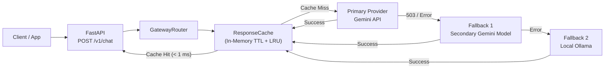

# Mini AI Gateway

A lightweight, modular **AI Gateway** built with **Python** and **FastAPI**, designed to centralize LLM access with provider abstraction, automatic fallback, and response caching.

## Architecture



## Features

- **Provider Abstraction (`LLMProvider`):** Decouples gateway routing from vendor SDKs (Gemini via `google-genai`, Ollama via `httpx`), making it easy to plug in new providers.
- **Routing & Automatic Fallback:** Executes an ordered chain of `(provider, model)` routes and automatically fails over on upstream errors (e.g., `503 UNAVAILABLE`, timeouts, connection failures).
- **Thread-Safe In-Memory Cache:** Deterministic SHA-256 cache keys with configurable TTL (`time.monotonic()`) and LRU eviction (`OrderedDict`) to reduce latency and token costs on repeated prompts.
- **Typed Configuration & Contracts:** Environment-based settings with `pydantic-settings` and strict request/response validation with Pydantic.
- **Normalized Metadata:** Every response reports `provider_usado`, `modelo_usado`, `latencia_ms`, `tokens_usados` (`input_tokens`, `output_tokens`, `total_tokens`), `cache_hit`, `fallback_usado`, and `tentativas`.

## Roadmap

- [x] **Step 1 — MVP:** FastAPI `POST /v1/chat` and `GET /health` integrated with Gemini API.
- [x] **Step 2 — Resilience:** Multi-model routing, automatic fallback (Gemini → secondary Gemini / Ollama), and thread-safe TTL + LRU cache.
- [ ] **Step 3 — Security & Observability:** PII guardrail (masking CPF, CNPJ, and emails before calling LLMs / LGPD), structured JSON logs, and `GET /metrics`.
- [ ] **Step 4 — Engineering:** Automated `pytest` suite with mocked providers, `Dockerfile`, and `docker-compose.yml`.

## Project Structure

```text
mini-ai-gateway/
├── app/
│   ├── main.py                  # FastAPI app, routes, dependency wiring
│   ├── config.py                # Typed settings loaded from .env
│   ├── schemas.py               # Pydantic request/response models
│   └── services/
│       ├── base.py              # LLMProvider interface, ProviderResult, exceptions
│       ├── gemini_client.py     # Google Gemini provider (google-genai)
│       ├── ollama_client.py     # Local Ollama provider (httpx)
│       ├── cache.py             # Thread-safe TTL + LRU in-memory cache
│       └── router.py            # Routing, fallback chain, and cache orchestration
├── .env.example
├── .gitignore
├── requirements.txt
└── README.md
```

## Quickstart

### 1. Create a virtual environment and install dependencies

```bash
python -m venv .venv
# Windows (PowerShell)
.\.venv\Scripts\Activate.ps1
# Linux / macOS
source .venv/bin/activate

pip install -r requirements.txt
```

### 2. Configure environment variables

Copy `.env.example` to `.env` and set your Gemini API key (and optional fallback models):

```env
GEMINI_API_KEY=your_gemini_api_key_here
GEMINI_MODEL=gemini-3.8-flash
GEMINI_FALLBACK_MODEL=gemini-2.5-flash-lite

# Optional local fallback via Ollama (leave OLLAMA_MODEL empty to disable)
OLLAMA_BASE_URL=http://localhost:11434
OLLAMA_MODEL=
OLLAMA_TIMEOUT_SECONDS=30

CACHE_TTL_SECONDS=300
CACHE_MAX_SIZE=256
APP_ENV=development
```

### 3. Run the server

```bash
uvicorn app.main:app --reload
```

Interactive API docs (Swagger UI) will be available at `http://127.0.0.1:8000/docs`.

## API Reference

### `GET /health`

Returns service status, active route chain, and current cache entry count.

```json
{
  "status": "ok",
  "app_name": "Mini AI Gateway",
  "environment": "development",
  "routes": [
    "gemini/gemini-3.8-flash",
    "gemini/gemini-2.5-flash-lite"
  ],
  "cache_entries": 1
}
```

### `POST /v1/chat`

**Request:**

```json
{
  "prompt": "Explique em 2 frases o que é um AI Gateway.",
  "system_prompt": "Responda de forma objetiva e técnica.",
  "use_cache": true
}
```

**Response:**

```json
{
  "resposta": "Um AI Gateway é uma camada intermediária entre aplicações e provedores de LLMs...",
  "provider_usado": "gemini",
  "modelo_usado": "gemini-3.8-flash",
  "latencia_ms": 612.45,
  "tokens_usados": {
    "input_tokens": 24,
    "output_tokens": 58,
    "total_tokens": 82
  },
  "cache_hit": false,
  "fallback_usado": false,
  "tentativas": 1
}
```
