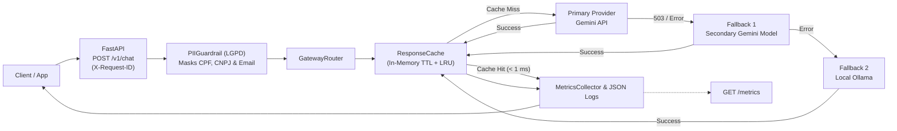

# Mini AI Gateway

A lightweight, production-inspired **AI Gateway** built with **Python**, **FastAPI**, and **Docker**, designed to centralize LLM access with provider abstraction, automatic fallback, response caching, LGPD PII guardrails, structured JSON logging, and real-time operational metrics.

## Architecture



## Features

- **Provider Abstraction (`LLMProvider`):** Decouples gateway routing from vendor SDKs (Gemini via `google-genai`, Ollama via `httpx`), making it easy to plug in new providers.
- **Routing & Automatic Fallback:** Executes an ordered chain of `(provider, model)` routes and automatically fails over on upstream errors (e.g., `503 UNAVAILABLE`, timeouts, connection failures).
- **Thread-Safe In-Memory Cache:** Deterministic SHA-256 cache keys with configurable TTL (`time.monotonic()`) and LRU eviction (`OrderedDict`) to reduce latency and token costs on repeated prompts.
- **LGPD PII Guardrail:** Masks formatted and unformatted CPFs/CNPJs (with official Brazilian mod-11 check-digit validation to minimize false positives) and emails *before* text reaches the cache, logs, or external LLM providers.
- **Structured JSON Logging & Tracing:** Single-line JSON logs ready for CloudWatch/ELK/Datadog, correlated by a per-request UUID (`request_id` / `X-Request-ID` header).
- **Operational Metrics (`GET /metrics`):** Tracks uptime, traffic, cache hit rate, fallback frequency, PII redactions by category, FinOps-accurate token consumption (cache hits are not double-counted), and latency (`avg`, `min`, `max`).
- **Automated Tests & Containerization:** 17 unit & integration tests with `pytest` (fully mocked, zero external API calls) plus a non-root `Dockerfile` and `docker-compose.yml`.

## Roadmap

- [x] **Step 1 — MVP:** FastAPI `POST /v1/chat` and `GET /health` integrated with Gemini API.
- [x] **Step 2 — Resilience:** Multi-model routing, automatic fallback (Gemini → secondary Gemini / Ollama), and thread-safe TTL + LRU cache.
- [x] **Step 3 — Security & Observability:** PII guardrail (masking CPF, CNPJ, and emails before calling LLMs / LGPD), structured JSON logs, and `GET /metrics`.
- [x] **Step 4 — Engineering:** Automated `pytest` suite with mocked providers, `Dockerfile`, `docker-compose.yml`, and complete architecture documentation.

## Project Structure

```text
mini-ai-gateway/
├── app/
│   ├── main.py                  # FastAPI app, routes, middleware/handlers, DI wiring
│   ├── config.py                # Typed settings loaded from .env
│   ├── schemas.py               # Pydantic request/response & metrics models
│   └── services/
│       ├── base.py              # LLMProvider interface, ProviderResult, exceptions
│       ├── gemini_client.py     # Google Gemini provider (google-genai)
│       ├── ollama_client.py     # Local Ollama provider (httpx)
│       ├── cache.py             # Thread-safe TTL + LRU in-memory cache
│       ├── router.py            # Routing, fallback chain, and cache orchestration
│       ├── guardrails.py        # LGPD PII guardrail (CPF, CNPJ, Email)
│       ├── logging_config.py    # Structured JSON log formatter
│       └── metrics.py           # Thread-safe operational metrics collector
├── tests/
│   ├── test_api.py              # FastAPI integration tests with mocked providers
│   ├── test_cache.py            # TTL expiration & LRU eviction tests
│   ├── test_guardrails.py       # CPF/CNPJ mod-11 & email redaction tests
│   └── test_router.py           # Routing, fallback & cache bypass tests
├── Dockerfile
├── docker-compose.yml
├── .dockerignore
├── .env.example
├── .gitignore
├── pytest.ini
├── requirements.txt
├── requirements-dev.txt
└── README.md
```

## Quickstart

### Option A — Run Locally with Python

```bash
python -m venv .venv
# Windows (PowerShell)
.\.venv\Scripts\Activate.ps1
# Linux / macOS
source .venv/bin/activate

pip install -r requirements-dev.txt
cp .env.example .env   # then add your GEMINI_API_KEY
uvicorn app.main:app --reload
```

### Option B — Run with Docker Compose

```bash
cp .env.example .env   # then add your GEMINI_API_KEY
docker compose up --build
```

To also start a local **Ollama** container as an offline fallback (set `OLLAMA_BASE_URL=http://ollama:11434` and `OLLAMA_MODEL=llama3.2:1b` in `.env`):

```bash
docker compose --profile local-llm up --build
```

Interactive API docs (Swagger UI) are available at `http://127.0.0.1:8000/docs`.

## Running Tests

All tests use mocked providers and require no external API keys or network access:

```bash
pytest -v
```

## API Reference

### `GET /health`

Returns service status, active route chain, cache size, and PII guardrail state.

```json
{
  "status": "ok",
  "app_name": "Mini AI Gateway",
  "environment": "development",
  "routes": [
    "gemini/gemini-3.8-flash",
    "gemini/gemini-2.5-flash-lite"
  ],
  "cache_entries": 1,
  "pii_guardrail_enabled": true
}
```

### `POST /v1/chat`

**Request:**

```json
{
  "prompt": "Resuma o atendimento do cliente CPF 123.456.789-00.",
  "system_prompt": "Responda de forma objetiva e técnica.",
  "use_cache": true
}
```

**Response (`X-Request-ID` header included):**

```json
{
  "request_id": "ecdc659f-188b-4d03-b00d-89306b4765c6",
  "answer": "Resumo do atendimento para o cliente [CPF_REDACTED]...",
  "provider": "gemini",
  "model": "gemini-3.8-flash",
  "latency_ms": 612.45,
  "tokens_used": {
    "input_tokens": 24,
    "output_tokens": 58,
    "total_tokens": 82
  },
  "cache_hit": false,
  "fallback": false,
  "attempts": 1,
  "pii_redacted": true,
  "redactions": {
    "cpf": 1
  }
}
```

### `GET /metrics`

Returns operational counters, cache efficiency, fallback counts, PII redactions, billed token consumption, and latency statistics.

```json
{
  "uptime_seconds": 142.85,
  "total_requests": 10,
  "successful_requests": 10,
  "failed_requests": 0,
  "cache_hits": 4,
  "cache_misses": 6,
  "cache_hit_rate": 0.4,
  "cache_entries": 6,
  "fallback_count": 1,
  "pii_redacted_requests": 2,
  "pii_redactions_by_type": {
    "cpf": 2,
    "email": 1
  },
  "requests_by_provider": {
    "gemini": 9,
    "ollama": 1
  },
  "requests_by_model": {
    "gemini-3.8-flash": 9,
    "llama3.2:1b": 1
  },
  "tokens_consumed": {
    "input_tokens": 180,
    "output_tokens": 310,
    "total_tokens": 490
  },
  "latency_ms": {
    "avg": 245.12,
    "min": 0.04,
    "max": 812.3
  }
}
```
